# mattermost-themes

22 組 Mattermost 自訂主題，11 組深色、11 組淺色。色系參考常見的編輯器主題，淺色主題刻意把背景壓暗一階，長時間看比較不刺眼。

## 套用方式

1. 開啟 Mattermost，進入 **設定 → 顯示 → 主題 → 自訂主題**
2. 找到「複製並貼上以分享主題色彩」輸入框
3. 把 `themes/` 底下任一 `.json` 的內容整段貼進去

每個檔案都是 Mattermost 匯出格式的單行 JSON，不需要改格式。

## 深色

| 預覽 | 主題 | 參考來源 |
|---|---|---|
| 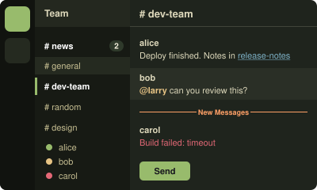 | **抹茶綠 Matcha** [`matcha-dark.json`](themes/matcha-dark.json) | 原創，以 [Kanagawa](https://github.com/rebelot/kanagawa.nvim) Wave 為底 |
| 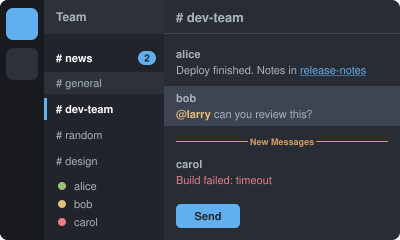 | **One Dark Pro** [`one-dark-pro.json`](themes/one-dark-pro.json) | [Binaryify/OneDark-Pro](https://github.com/Binaryify/OneDark-Pro) |
| 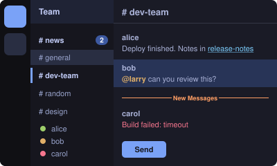 | **Tokyo Night** [`tokyo-night.json`](themes/tokyo-night.json) | [enkia/tokyo-night-vscode-theme](https://github.com/enkia/tokyo-night-vscode-theme) |
| 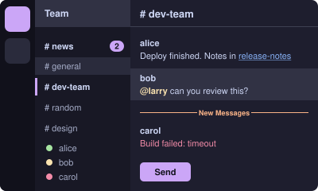 | **Catppuccin Mocha** [`catppuccin-mocha.json`](themes/catppuccin-mocha.json) | [catppuccin/catppuccin](https://github.com/catppuccin/catppuccin) |
| 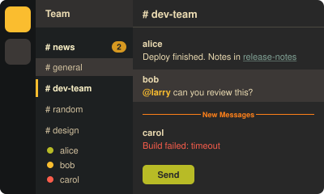 | **Gruvbox Dark** [`gruvbox-dark.json`](themes/gruvbox-dark.json) | [morhetz/gruvbox](https://github.com/morhetz/gruvbox) |
| 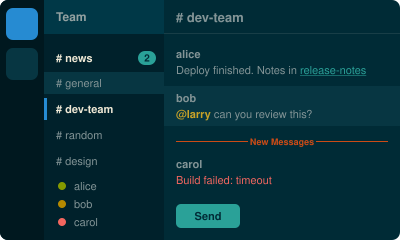 | **Solarized Dark** [`solarized-dark.json`](themes/solarized-dark.json) | [altercation/solarized](https://github.com/altercation/solarized) |
| 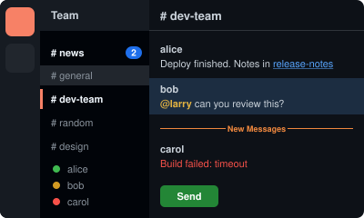 | **GitHub Dark** [`github-dark.json`](themes/github-dark.json) | [primer/github-vscode-theme](https://github.com/primer/github-vscode-theme) |
| 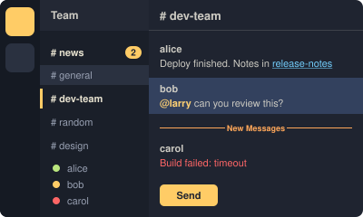 | **Ayu Mirage** [`ayu-mirage.json`](themes/ayu-mirage.json) | [ayu-theme/ayu-colors](https://github.com/ayu-theme/ayu-colors) |
| 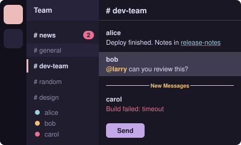 | **Rosé Pine** [`rose-pine.json`](themes/rose-pine.json) | [rose-pine/rose-pine-theme](https://github.com/rose-pine/rose-pine-theme) |
| 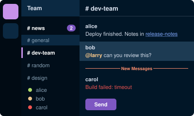 | **Night Owl** [`night-owl.json`](themes/night-owl.json) | [sdras/night-owl-vscode-theme](https://github.com/sdras/night-owl-vscode-theme) |
| 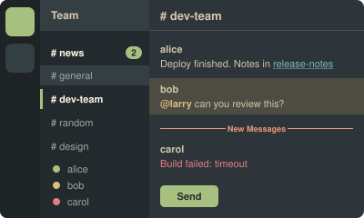 | **Everforest Dark** [`everforest-dark.json`](themes/everforest-dark.json) | [sainnhe/everforest](https://github.com/sainnhe/everforest) |

## 淺色

| 預覽 | 主題 | 參考來源 |
|---|---|---|
| 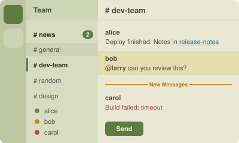 | **抹茶綠 Matcha** [`matcha-light.json`](themes/matcha-light.json) | 原創，對應 Kanagawa Lotus，整體壓暗降低對比 |
| 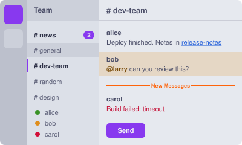 | **Catppuccin Latte** [`catppuccin-latte.json`](themes/catppuccin-latte.json) | [catppuccin/catppuccin](https://github.com/catppuccin/catppuccin)，頻道背景取 mantle |
| 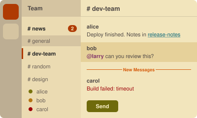 | **Gruvbox Light** [`gruvbox-light.json`](themes/gruvbox-light.json) | [morhetz/gruvbox](https://github.com/morhetz/gruvbox)，採 soft 背景 |
| 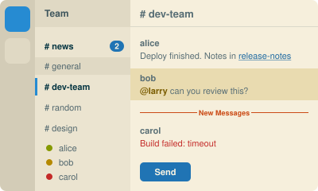 | **Solarized Light** [`solarized-light.json`](themes/solarized-light.json) | [altercation/solarized](https://github.com/altercation/solarized)，背景略微壓暗 |
| 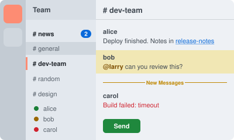 | **GitHub Light** [`github-light.json`](themes/github-light.json) | [primer/github-vscode-theme](https://github.com/primer/github-vscode-theme) |
| 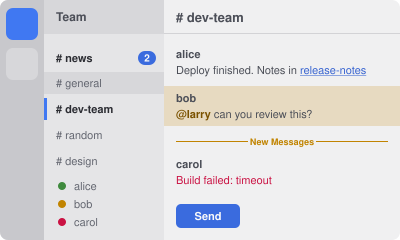 | **One Light** [`one-light.json`](themes/one-light.json) | Atom One Light，如 [akamud/vscode-theme-onelight](https://github.com/akamud/vscode-theme-onelight) |
| 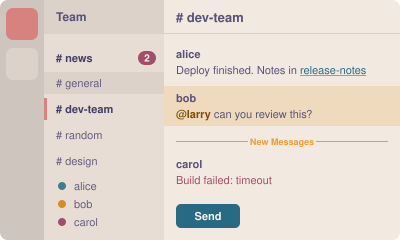 | **Rosé Pine Dawn** [`rose-pine-dawn.json`](themes/rose-pine-dawn.json) | [rose-pine/rose-pine-theme](https://github.com/rose-pine/rose-pine-theme) |
| 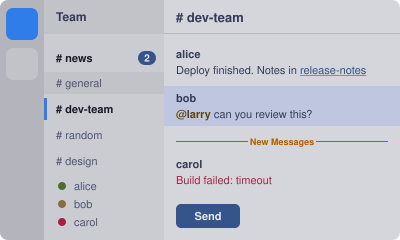 | **Tokyo Night Day** [`tokyo-night-day.json`](themes/tokyo-night-day.json) | [enkia/tokyo-night-vscode-theme](https://github.com/enkia/tokyo-night-vscode-theme) 的 Light 版 |
| 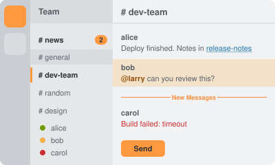 | **Ayu Light** [`ayu-light.json`](themes/ayu-light.json) | [ayu-theme/ayu-colors](https://github.com/ayu-theme/ayu-colors) |
| 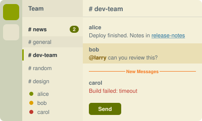 | **Everforest Light** [`everforest-light.json`](themes/everforest-light.json) | [sainnhe/everforest](https://github.com/sainnhe/everforest) |
| 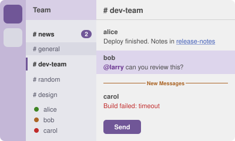 | **Quiet Light** [`quiet-light.json`](themes/quiet-light.json) | VS Code 內建 Quiet Light |

## 注意事項

- 色票是參考各主題的主色與強調色後，對應到 Mattermost 的 25 個欄位，不是官方移植，部分色碼為了對比度或層次做過微調。
- 內文、側欄文字、未讀、連結、錯誤、按鈕與 mention 等文字配對的對比度皆在 4.5 : 1 以上（WCAG AA）。
- `mentionBj` 是 Mattermost 本身的欄位名稱，不是筆誤。
- `codeTheme` 只能從 `github`、`monokai`、`solarized-dark`、`solarized-light` 四種選一種，淺色主題的程式碼區塊底色會比頻道背景略亮。
- 各主題的名稱與配色版權屬原作者，本專案與其無隸屬關係。

## 授權

[MIT](LICENSE)
